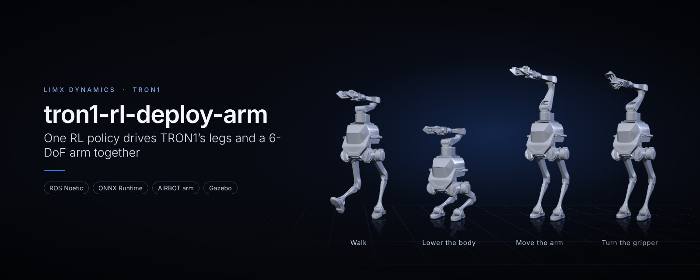
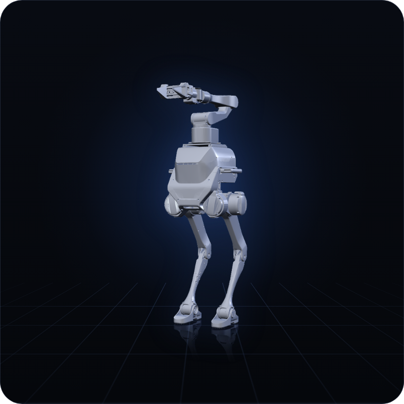
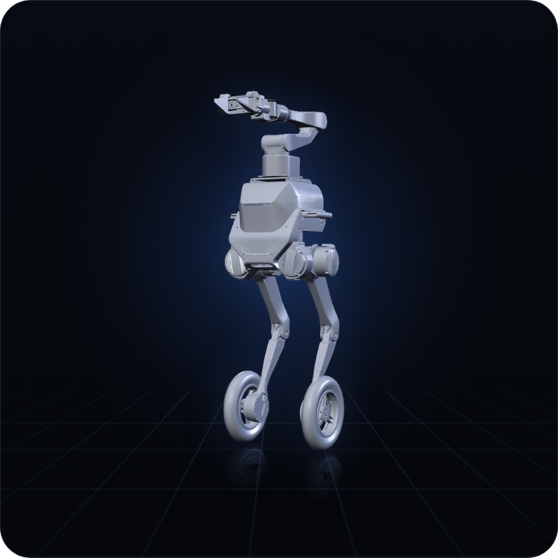
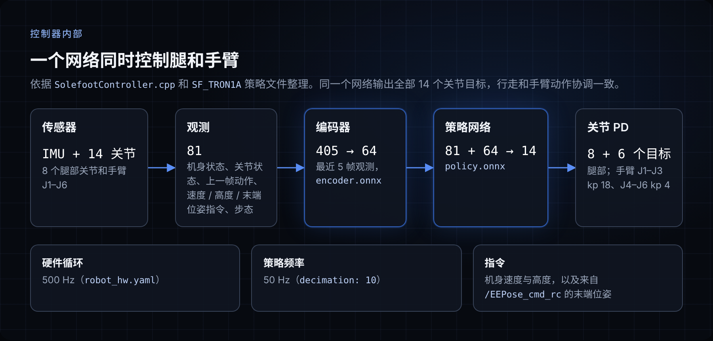
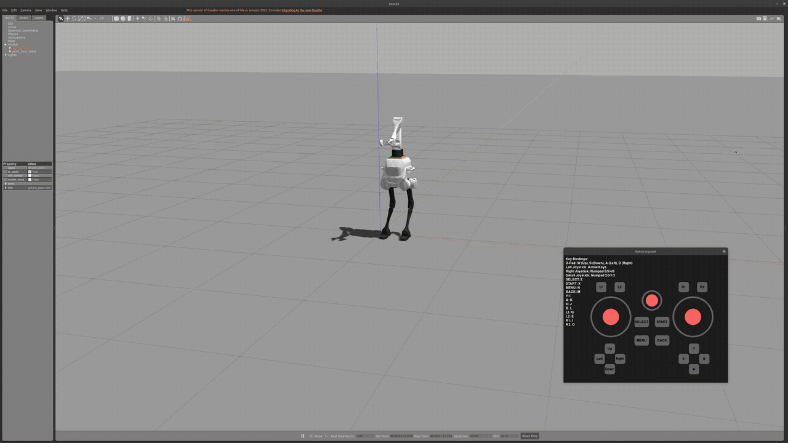

<p align="center">
  
</p>

<p align="center">
  <a href="README.md">English</a> | <b>中文</b>
</p>

<p align="center">
  <a href="LICENSE"></a>
  
  
  
  <a href="https://github.com/limxdynamics/limxdynamics/blob/main/doc/wechat_qr.png"></a>
</p>
<p align="center"><sub>合作采购请联系 <a href="mailto:opensource@limxdynamics.com">opensource@limxdynamics.com</a></sub></p>

# 训练结果部署

> **TRON1 开源生态的一部分。** 上手路线和其他 TRON1 仓库：[TRON1 快速上手](https://github.com/limxdynamics/limxdynamics/blob/main/doc/quickstart_cn.md#tron1)。

**TRON1 移动操作：一个 RL 策略同时让机器人行走并控制 6 自由度手臂。** 在 ROS Noetic 的 Gazebo 中运行，通过虚拟遥控器用键盘操作。

## 亮点

- **一个网络完成全身控制。** 策略同时输出全部 14 个关节目标（腿部 8 个、手臂 6 个），手臂伸出时机身依然保持平衡。
- **工作空间自带全部依赖。** 机器人模型、Gazebo 插件、LimX SDK、ONNX Runtime 和机械臂 SDK 都在 `src/` 下，克隆后直接 `catkin_make install`。
- **两款带臂机型。** 提供装有手臂的双足（`SF_TRON1A`）和轮足（`WF_TRON1A`）TRON1 的训练好的策略。
- **键盘即可操作。** [`robot-joystick`](https://github.com/limxdynamics/robot-joystick) 把方向键映射为行走、小键盘映射为机身高度、`WASD` / `IJKL` 映射为末端位姿。

## 机器人型号

| | 型号 | 说明 | 驱动自由度 | `ROBOT_TYPE` |
| :-: | --- | --- | :-: | --- |
|  | **双足 + 手臂** | 带踝关节和平底足的双足，机身装 6 自由度手臂（J1–J6） | 8 + 6 | `SF_TRON1A` |
|  | **轮足 + 手臂** | 轮腿底盘，机身装 6 自由度手臂（J1–J6） | 8 + 6 | `WF_TRON1A` |

图片由本仓库 `src/robot-description/pointfoot/<ROBOT_TYPE>/urdf/robot_with_arm.urdf` 以同一相机和灯光渲染。

## 工作原理

<p align="center">
  
</p>

## 安装与运行

### 1. 部署环境配置

- 安装ROS Noetic：我们推荐在Ubuntu 20.04操作系统上建立基于ROS Noetic的算法开发环境。ROS提供了一系列工具和库，如核心库、通信库和仿真工具（如Gazebo），极大地便利了机器人算法的开发、测试和部署。这些资源为用户提供了一个丰富而完整的算法开发环境。ROS Noetic 安装请参考文档：https://wiki.ros.org/noetic/Installation/Ubuntu ，选择“ros-noetic-desktop-full”进行安装。ROS Noetic 安装完成后，Bash终端输入以下Shell命令，安装开发环境所依赖的库：

    ```bash
    sudo apt-get update
    sudo apt install ros-noetic-urdf \
                 ros-noetic-kdl-parser \
                 ros-noetic-urdf-parser-plugin \
                 ros-noetic-hardware-interface \
                 ros-noetic-controller-manager \
                 ros-noetic-controller-interface \
                 ros-noetic-controller-manager-msgs \
                 ros-noetic-control-msgs \
                 ros-noetic-ros-control \
                 ros-noetic-gazebo-* \
                 ros-noetic-robot-state-* \
                 ros-noetic-joint-state-* \
                 ros-noetic-rqt-gui \
                 ros-noetic-rqt-controller-manager \
                 ros-noetic-plotjuggler* \
                 cmake build-essential libpcl-dev libeigen3-dev libopencv-dev libmatio-dev \
                 python3-pip libboost-all-dev libtbb-dev liburdfdom-dev liborocos-kdl-dev -y
    ```

### 2. 编译运行

项目基于ros_control (https://wiki.ros.org/ros_control) 框架实现。可以按照以下步骤，编译运行：

- 打开一个Bash终端。

- 下载源代码：
    ```bash
    git clone https://github.com/limxdynamics/tron1-rl-deploy-arm.git
    ```

- 编译工程：
    ```bash
    cd tron1-rl-deploy-arm
    catkin_make install
    ```

- 选择机器人类型

  - 通过 Shell 命令 `tree -L 1 src/robot-description/pointfoot` 列出可用的机器人类型：

    ```
    src/robot-description/pointfoot
    ├── SF_TRON1A
    └── WF_TRON1A
    ```

  - 以`SF_TRON1A`（请根据实际机器人类型进行替换）为例，设置机器人型号类型：

    ```bash
    echo 'export ROBOT_TYPE=SF_TRON1A' >> ~/.bashrc && source ~/.bashrc
    ```

- 打开新的命令窗口，下载虚拟遥控器：
    ```bash
    git clone https://github.com/limxdynamics/robot-joystick.git
    ```

- 运行仿真

  通过运行Shell命令启动Gazebo仿真器，然后在仿真器窗口中按 `Ctrl + Shift + R`，机器人将开始移动。

  ```bash
  source install/setup.bash
  roslaunch robot_hw pointfoot_hw_sim.launch
  ```

  开启虚拟遥控器
    ```bash
    ./robot-joystick/robot-joystick
    ```

  开启虚拟遥控器后，可以用以下按键控制机器人：

  | 按键 | 动作 |
  | --- | --- |
  | 方向键 ↑↓←→ | 控制机器人前后左右移动 |
  | 小键盘 `8` / `5` | 控制机器人升高 / 降低 |
  | `W` `A` `S` `D` | 控制机械臂四方向平移 |
  | `I` `J` `K` `L` | 控制机械臂四方向旋转 |

  以双足为例效果如下

  

## 许可证

见 [LICENSE](LICENSE)。`src/` 下随附的第三方组件见 [NOTICE](NOTICE)。
