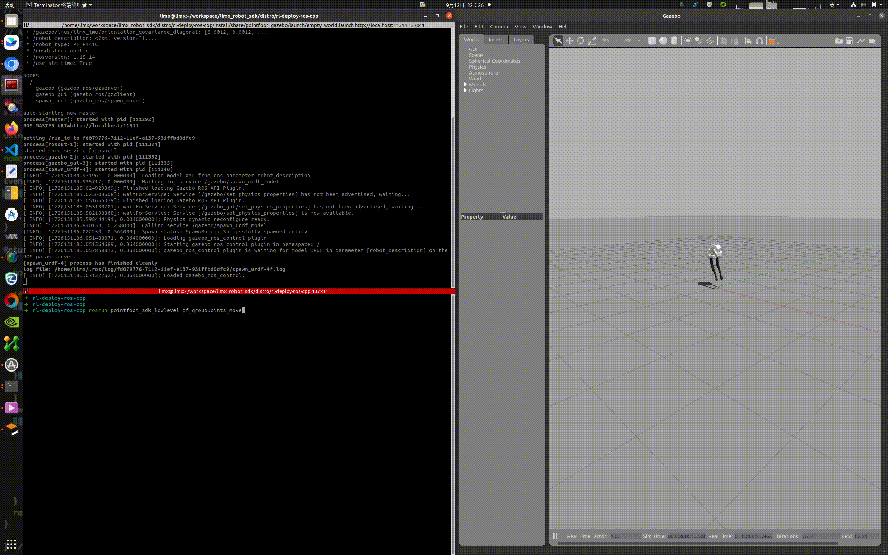

# pointfoot-gazebo-ros

**English** | [中文](README_cn.md)

## 1. Set up the development environment

We recommend setting up an algorithm development environment based on ROS Noetic on Ubuntu 20.04. ROS provides a set of tools and libraries, such as core libraries, communication libraries and simulation tools (such as Gazebo), which make it much easier to develop, test and deploy robot algorithms. Together they give you a rich and complete environment for algorithm development.

To install ROS Noetic, follow https://wiki.ros.org/noetic/Installation/Ubuntu and choose "ros-noetic-desktop-full". After ROS Noetic is installed, run the following in a Bash terminal to install the libraries the development environment depends on:

```
sudo apt-get update
sudo apt install ros-noetic-urdf \
                 ros-noetic-kdl-parser \
                 ros-noetic-urdf-parser-plugin \
                 ros-noetic-hardware-interface \
                 ros-noetic-controller-manager \
                 ros-noetic-controller-interface \
                 ros-noetic-controller-manager-msgs \
                 ros-noetic-control-msgs \
                 ros-noetic-ros-control \
                 ros-noetic-gazebo-* \
                 ros-noetic-rqt-gui \
                 ros-noetic-rqt-controller-manager \
                 ros-noetic-plotjuggler* \
                 cmake build-essential libpcl-dev libeigen3-dev libopencv-dev libmatio-dev \
                 python3-pip libboost-all-dev libtbb-dev liburdfdom-dev liborocos-kdl-dev -y
```

## 2. Create a workspace

Follow these steps to create an algorithm development workspace:

- Open a Bash terminal.

- Create a new directory for the workspace. For example, create a directory named "limx_ws" in your home directory:

  ```
  mkdir -p ~/limx_ws/src
  ```

- Download the motion control development interface:

  ```
  cd ~/limx_ws/src
  git clone https://github.com/limxdynamics/pointfoot-sdk-lowlevel.git
  ```

- Download the Gazebo simulator:

  ```
  cd ~/limx_ws/src
  git clone https://github.com/limxdynamics/pointfoot-gazebo-ros.git
  ```

- Download the robot description files:

  ```
  cd ~/limx_ws/src
  git clone https://github.com/limxdynamics/robot-description.git
  ```

- Build the workspace:

  ```
  cd ~/limx_ws
  catkin_make install
  ```

- Choose the robot type

  - List the available robot types with `tree -L 1 src/robot-description/pointfoot `:

    ```
    src/robot-description/pointfoot
    ├── PF_P441A
    ├── PF_P441B
    ├── PF_P441C
    ├── PF_P441C2
    ├── PF_TRON1A
    ├── SF_TRON1A
    └── WF_TRON1A
    ```

  - Taking `PF_P441C` as an example (replace it with your actual robot type), set the robot type:

    ```
    echo 'export ROBOT_TYPE=PF_P441C' >> ~/.bashrc && source ~/.bashrc
    ```

- Run the simulation:

  ```
  source install/setup.bash
  roslaunch pointfoot_gazebo empty_world.launch
  ```

- Run the control example. If the robot moves in the simulator, the simulation environment is set up:

  ```
  source install/setup.bash
  rosrun pointfoot_sdk_lowlevel pf_groupJoints_move
  ```
  
