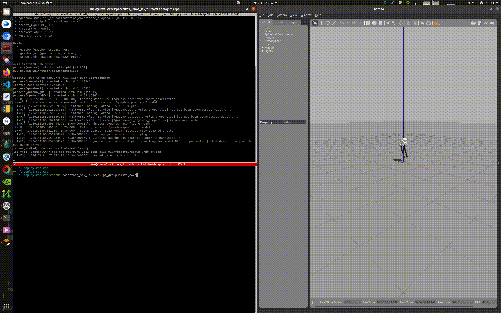

# pointfoot-gazebo-ros（内置副本）

[English](README.md) | **中文**

这是 `tron1-rl-deploy-arm` 工作空间内置的 TRON1 Gazebo 仿真器（`pointfoot_gazebo` 和 `pointfoot_sdk_sim`），随 `src/` 下的其他包一起编译，不需要单独克隆或编译。请按根目录 [README](../../README_cn.md) 操作：安装依赖、克隆本仓库，在工作空间根目录执行 `catkin_make install`，然后用 `roslaunch robot_hw pointfoot_hw_sim.launch` 启动仿真。

> 不要再把 `pointfoot-gazebo-ros`、`pointfoot-sdk-lowlevel` 或 `robot-description` 克隆进这个工作空间。它们已经在 `src/` 下，重复的副本会导致 catkin 包重名、编译失败。

## 机型

本工作空间只支持两款带机械臂的 TRON1：`SF_TRON1A`（双足）和 `WF_TRON1A`（轮足），模型在 [`src/robot-description/pointfoot/`](../robot-description/pointfoot)。`ROBOT_TYPE` 的设置方法见根目录 README。

## 单独使用仿真器

在本工作空间之外，请使用独立仓库 [tron1-gazebo-ros](https://github.com/limxdynamics/tron1-gazebo-ros)（原 `pointfoot-gazebo-ros`），并配合 [limxsdk-lowlevel](https://github.com/limxdynamics/limxsdk-lowlevel) 和 [tron1-robot-description](https://github.com/limxdynamics/tron1-robot-description) 使用。
